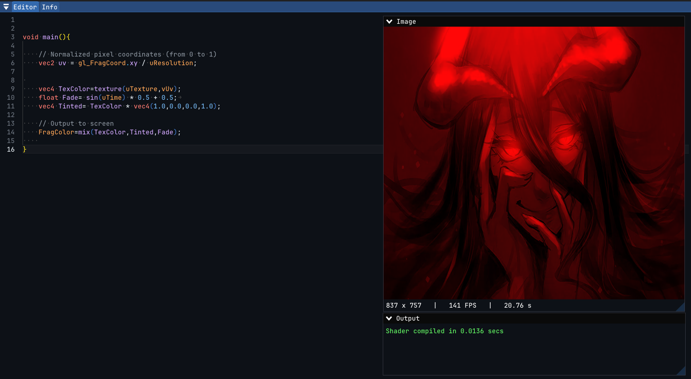
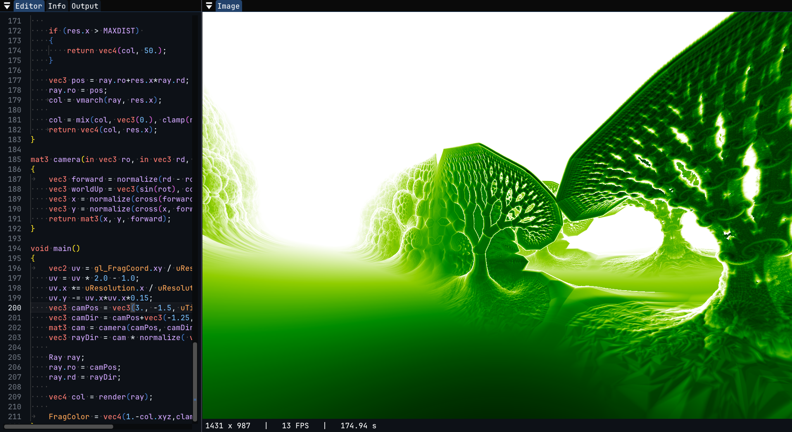
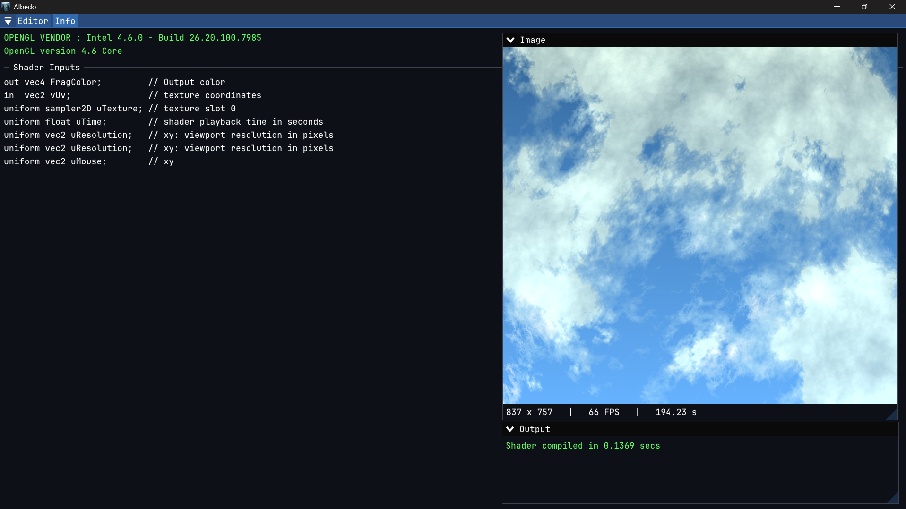

<h1 align="center">Albedo</h1>


GLSL fragment shader renderer and editor.


Program your shader and see it changing side by side. Written in modern C++ for speed.

## Features
- Fast shader compilation and rendering 
- Resizable panels : editors, scene , log 
- Github like syntax highlighting and error message.
- Dark window title bar ( I'm so proud of this ) 


## Gallery 



----

**Shader Credit** : https://www.shadertoy.com/view/llXfRr




**Shader credit** : https://www.shadertoy.com/view/4tdSWr



## Setup

```powershell
# 1. Clone the repo
git clone https://github.com/ArcShahi/Albedo.git

# 2. Go inside directory and call CMake
cmake -B out\

#  Files will be build in 'out' directory
# 3. Call your build systerm or : 
cmake -build out --config release

# If using Visual Studio 
#  1. Directly open the dir using it. 
#  2. Go to CMakeLists.txt and save it. It'll build the project.

```


## Credits
1. TheCherno: His OpenGL series has helped me a lot and I've also learned to architech software(somewhat) from him. What I had was an overengineered , overkill abomination. The app flow is much simpler now.
1. LearnOpenGL: What a great site to learn OpenGL 


## Vendors

- **GLFW** : For Window
- **GLAD** : For OpenGL "Loader" to give us the GPU drive implemented OpenGL specification.
- **ImGUI**: For UI
- **STB**  : For texture loading 
- **GLM**  : Why not.
- **goossens/ImGuiColorTextEdit** : Text editor and syntax highlighting

## AI POLICY 

AI is a tool and is used as a tool to make things convinient.. not to suck the fun of art and craft.

AI usage for Code generation and documentation is forbidden for this project.

### AI usage disclosure

The follwing are  LLM generated : 
- `dependencies.cmake` 
- `CMakePresets.json` 
- `GlslTheme.hpp`
- CMLs in Vendors directories.


> Shahi ( *prefers natural stupidity over artifical intelligence*)


## TODO
- Mulipass : I'll not add it until I am able to create some shader art that does require multipass.


----